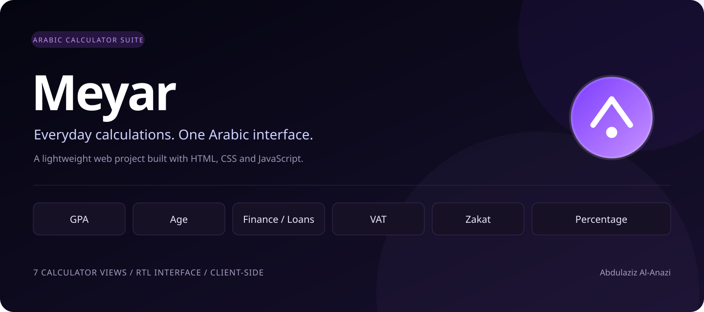
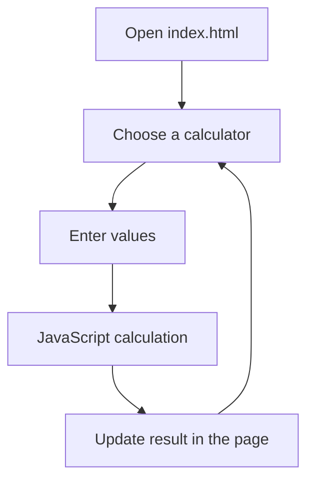

<div align="center">

# معيار | Meyar
### Everyday calculations, in one Arabic interface.

A lightweight browser-based calculator suite for academic and everyday tasks, built with HTML, CSS, and vanilla JavaScript.


**7 calculator views · Arabic interface · Dark theme · No backend**

</div>

---

## Project Cover



*Project cover based on the application's existing logo and dark-purple palette.*

## Overview

**Meyar (معيار)** brings seven calculator views into a single Arabic, right-to-left web interface. Users can switch between academic, age, financing, and percentage calculations from a sidebar. Calculations run locally in the browser; the current application does not require an account, database, or API.

The interface uses a dark palette with purple accents, editable inputs, and result cards.

## Calculators

| Calculator | Current functionality |
| :--- | :--- |
| GPA | Enter course hours and grades; display weighted points, total hours, and a semester result. |
| Age | Calculate completed years from a date of birth. |
| Finance | Estimate a monthly installment from an amount, term, and annual rate. |
| Loans | A separate loan view using the same installment formula. |
| VAT | Calculate tax and the total amount using an entered percentage. |
| Zakat | Calculate 2.5% of an entered amount. |
| Percentage | Calculate a part as a percentage of a total. |

## Project Structure

| Path | Purpose |
| :--- | :--- |
| `index.html` | Application entry point; contains the current markup, inline CSS, and working JavaScript. |
| `app.js` | Separate GPA script retained in the repository; not loaded by the current entry point. |
| `style.css` | Separate style rules retained in the repository; not loaded by the current entry point. |
| `project -meyar-calculator/` | Duplicate copies of the three application files. |
| `.github/workflows/static.yml` | GitHub Actions workflow for publishing static content to GitHub Pages. |
| `docs/images/meyar-cover.svg` | Project cover used in this README. |
| `README.md` | Project description, structure, setup, and implementation notes. |

## How It Works



## Run Locally

No package installation or build step is required.

```bash
git clone https://github.com/aziz123098/meyar-calculator.git
cd meyar-calculator
```

Open `index.html` in a browser. Alternatively, if Python is installed:

```bash
python3 -m http.server 8000
```

Then open [localhost:8000](http://localhost:8000).

## Implementation Notes

This repository is a frontend prototype. The following limitations are visible in the current source:

- **GPA scale:** Selecting a 4- or 5-point scale changes the displayed scale and classification thresholds, but not the grade-point mapping. Scale-specific mappings need to be implemented before relying on results.
- **Reset button:** The current inline application script does not attach a handler to the reset button.
- **Input validation:** Several calculators need stronger handling of zero, negative, and invalid inputs.
- **Mobile layout:** The current page uses a fixed-width sidebar and has no responsive breakpoints or viewport metadata.
- **Financial calculations:** Installment estimates do not include provider fees; the zakat view is a percentage calculation, not an eligibility assessment.

## Development Priorities

- [ ] Implement and verify separate GPA mappings.
- [ ] Connect the reset action and improve input validation.
- [ ] Add a mobile-friendly layout.
- [ ] Consolidate duplicate files and separate application logic and styles.
- [ ] Add automated checks for calculator formulas and edge cases.

## Author

**Abdulaziz Al-Anazi** · [GitHub](https://github.com/aziz123098)
