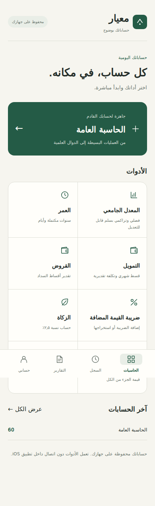
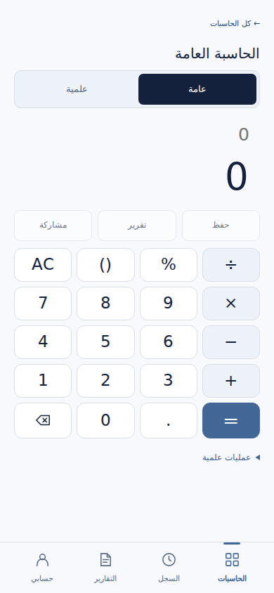
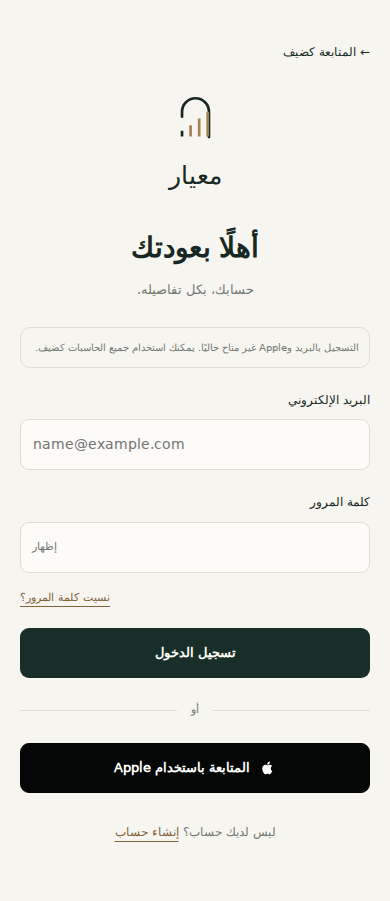
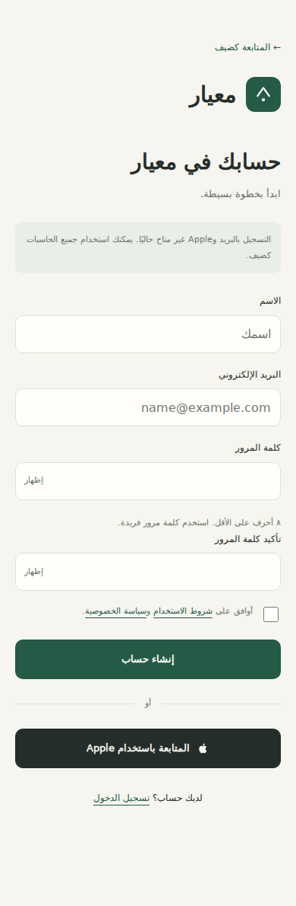
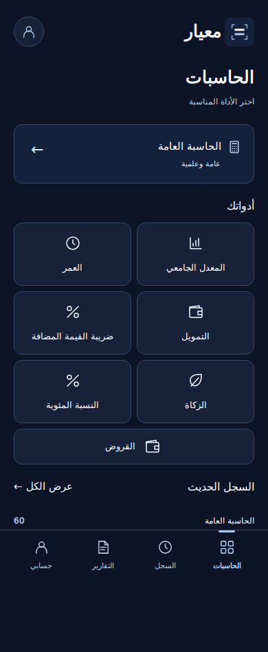
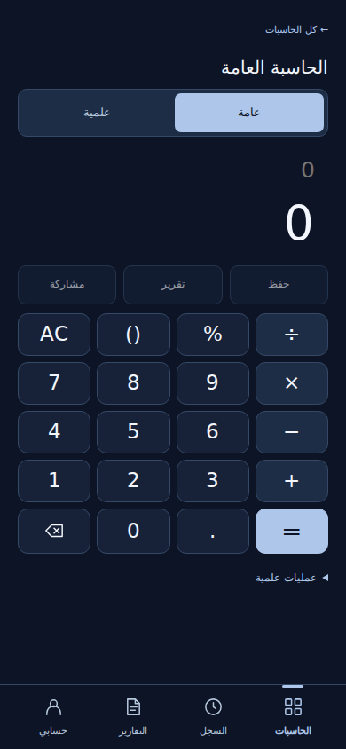

# Meyar 0.3 design

Ivory #f6f5ef, forest #245b46, ink #242d29. Bundled Arabic font, compact outlined icons, 10–16px corner radius and 48px minimum primary tap targets. Dark appearance follows the device or the user selection.

Routes: home, general, gpa, age, finance, loans, vat, zakat, percent, history, reports, settings, welcome, login, signup, forgot, verify, reset-password.

Authentication screens are explicitly unavailable until a secure backend and Sign in with Apple are configured. They validate inputs but do not transmit or persist passwords, create accounts, send email, or show false success. Verification/reset screens are scaffolding only. Account deletion and signed-in profile/logout must be implemented with real authentication.

Reports support selection, optional title, HTML content preview and PDF export/native sharing. History remains local; theme is a separate preference. Existing calculations and saved record format are retained. Native visual QA remains required.

## Screens

## Approved premium direction — 0.3.1

Porcelain #f7f5ef, ink #172824 and bronze #a28353. Arch/tick monogram. Calculator has an integrated result display and equals key. Dark mode uses #111916 with warm light text and brighter bronze. Appearance supports explicit light/dark or automatic system preference; selection is persisted locally.

## System type and calculator mark

UI uses the native system font first, with bundled Arabic fallback. Numerals use the same system family. The calculator outline combines plus/equal symbols and measurement ticks to convey calculation and precision. PDF Arabic font remains bundled for export reliability.

## Rendering repair

After native missing-glyph reports, the packaged Arabic font takes precedence again. UI logos load the packaged PNG rendition. Native asset catalog still uses the 1024px icon. A fresh Xcode build is required; browser checks cannot verify the affected simulator.
